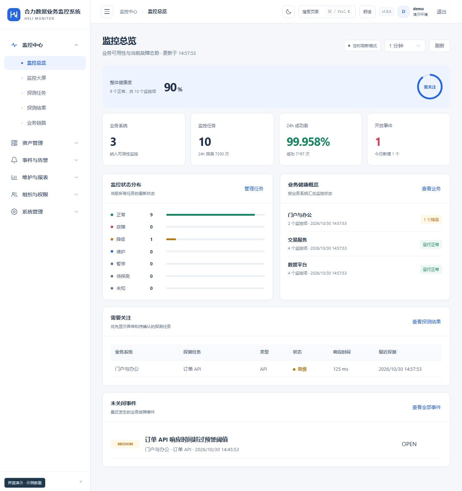
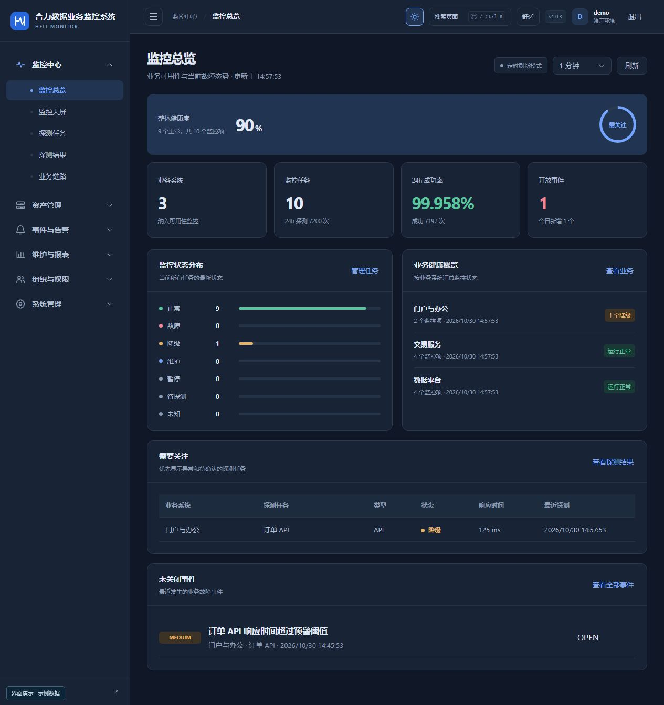
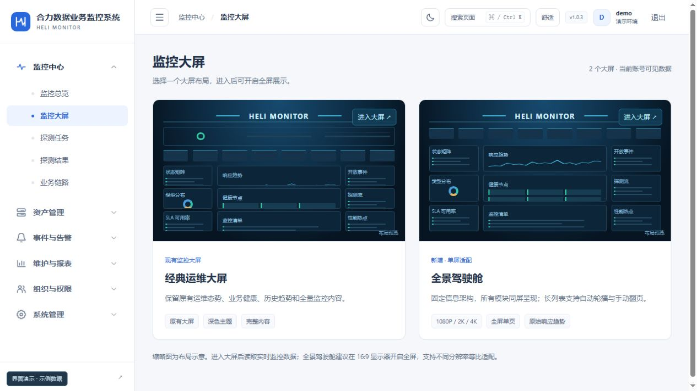
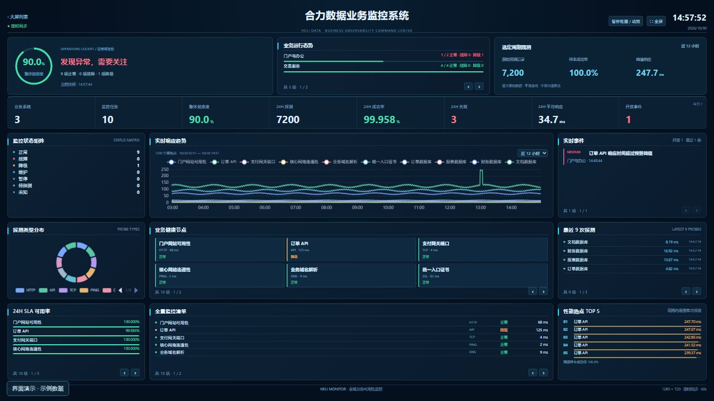
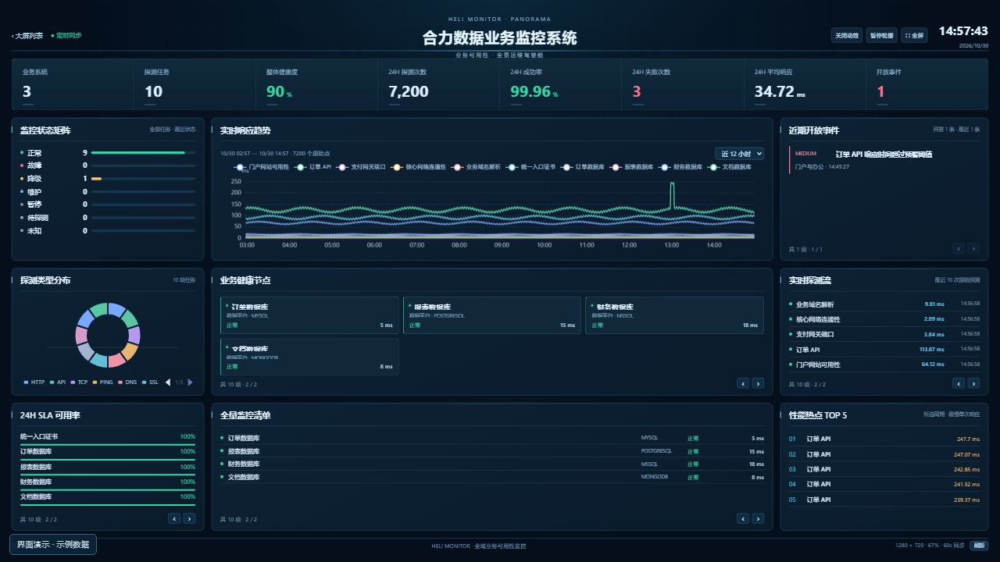
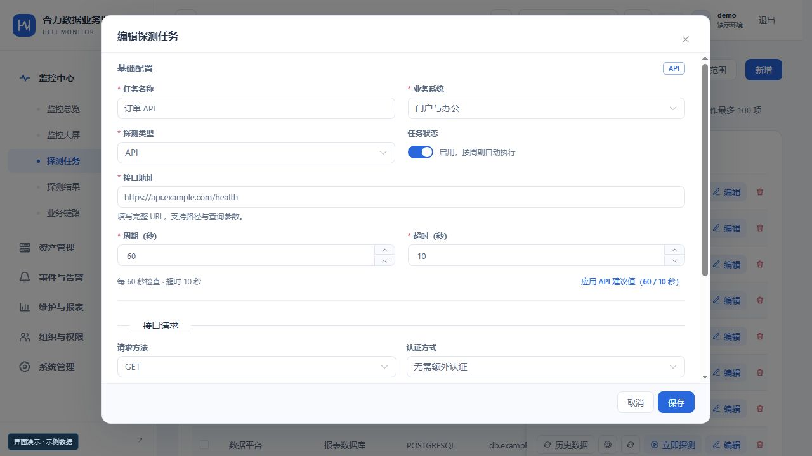
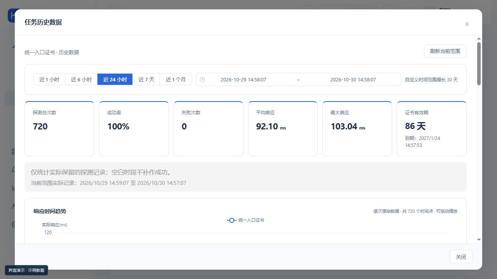

# Heli Monitor · 合力数据业务监控系统

**版本：v1.0.3 · 发布日期：2026-10-30 · 文档更新：2026-10-30**

面向业务可用性的监控与运维管理平台。通过网络、接口和数据库探测采集实际结果，集中展示业务状态、响应趋势、故障事件及 SLA，并按规则投递告警通知。

## 界面预览

以下图片由 v1.0.3 的实际 Vue 页面及组件渲染，使用明确标注的**演示数据**，不代表生产运行状态；域名、业务和指标均为展示示例。截图来源见 [截图说明](docs/screenshots/README.md)。

### 监控总览

集中查看业务健康度、探测状态、响应时间及待处理事件，管理界面支持浅色和深色主题。



<details>
<summary>查看深色主题</summary>



</details>

### 大屏选择与展示

从缩略图选择“经典运维大屏”或“全景驾驶舱”。两套布局均支持自适应及全屏，较长列表通过分页与轮播查看。



<details>
<summary>经典运维大屏：运维态势、业务指标和监控面板同屏展示</summary>



</details>

<details>
<summary>全景驾驶舱：原始响应趋势与九个内容面板</summary>



</details>

### 探测配置与证书历史

常用参数紧凑排列，高级请求配置及告警策略按需展开。SSL 任务历史弹窗显示证书有效期天数与到期时间，汇总历史趋势页不显示证书卡片。

<details>
<summary>查看 API 任务编辑界面</summary>



</details>

<details>
<summary>查看 SSL 任务历史弹窗</summary>



</details>

## v1.0.3 更新

- 新增监控大屏选择页，提供“经典运维大屏”和“全景驾驶舱”两套布局。
- 两套大屏均支持一屏展示、浏览器全屏及随窗口变化自动调整；适配 1080P、2K、4K、超宽屏和 16:10 等比例。长清单支持手动翻页、自动轮播；不通过截断列表隐藏任务。
- 大屏使用独立深色主题，提供可关闭的轻量动效；响应趋势默认查询最近 12 小时，可切换周期，使用逐次原始数据和平滑曲线。
- 统一管理平台的导航、品牌、表单、表格、弹窗、图表与浅色/深色主题，完善状态页及移动端交互。
- 探测任务编辑采用紧凑双列布局，按协议展示参数，折叠高级连接选项和告警策略；新增任务提供周期、超时建议，编辑时保留已有配置。
- 简化 HTTP/API 请求体、认证与响应校验配置。支持 Bearer、Basic、API Key、OAuth2 客户端凭据；已移除“登录获取 Token”认证选项。
- SSL 探测记录证书到期时间和有效期天数，支持到期前预警及关联规则通知。任务历史弹窗顶部保留证书有效期卡片；汇总历史趋势页不显示该卡片。
- 同步根目录版本、前端版本显示、后端 OpenAPI 版本及 Git 标签为 v1.0.3。

## 功能范围

| 模块 | 主要功能 |
| --- | --- |
| 监控中心 | 总览、双布局大屏、任务管理、结果明细、历史趋势、业务链路 |
| 探测协议 | HTTP、API、TCP、PING、DNS、SSL、MySQL/MariaDB、PostgreSQL、SQL Server、MongoDB |
| 任务管理 | 新增、编辑、复制、启停、立即探测、批量操作及历史数据弹窗 |
| 资产管理 | 业务系统、分组、标签及关联关系 |
| 事件与告警 | 故障事件确认、处理与关闭；告警规则、持续提醒、恢复通知、投递记录及重试 |
| 通知渠道 | SMTP 邮件、Webhook、企业微信、钉钉、Server 酱 |
| 维护与报表 | 维护窗口、样本口径 SLA、CSV 导出、公开或受令牌保护的状态页 |
| 组织与权限 | 用户、部门、角色及模块功能授权 |
| 系统管理 | 品牌、刷新周期、登录记录、审计日志、系统健康和维护操作 |

历史趋势最长查询 30 天。响应曲线展示实际保留的逐次记录，不按时间桶取平均；统计卡片另行提供平均值、最大值和成功率。无记录的时段不补作成功。历史保留受系统清理策略影响，已清理记录无法恢复。

**删除探测任务会永久删除相关探测历史。** 普通启停和编辑不会删除历史。权限按模块功能控制，目前不提供部门或个人级数据行隔离。通知和认证敏感字段通过现有加密机制保存；不要将生产凭据提交到代码仓库。

详细参数见 [探测任务与历史数据](docs/monitor-options.md)，界面规范见 [前端设计说明](frontend/DESIGN.md)。

## 架构与目录

- 后端：Python 3.12、Django 5、DRF、Channels、Celery。
- 前端：Vue 3、TypeScript、Element Plus、ECharts、Vite。
- 数据与队列：PostgreSQL 16、Redis 7。
- 部署：Docker Compose、Nginx；Web、Worker、Beat 分进程运行。

```text
backend/              API、探测执行、告警、权限、数据库迁移与测试
frontend/             管理界面、监控大屏、组件与前端测试
deploy/nginx/         反向代理配置
scripts/              应用管理及 HTTP 冒烟检查
docs/                 使用说明
offline/              离线安装与打包脚本
VERSION               v1.0.3
docker-compose.yml    在线构建与部署
.env.example          环境配置模板
```

## 安装与部署

准备 Linux、Docker Engine 24+ 和 Docker Compose v2。建议起步配置为 4 核 CPU、8 GB 内存；实际资源和磁盘需求取决于任务数量、探测周期和数据保留量。

```bash
git clone https://github.com/leichuanxing/heli_monitor.git
cd heli_monitor
git checkout v1.0.3
cp .env.example .env
chmod 600 .env
```

部署前编辑 `.env`：

- 设置随机 `DJANGO_SECRET_KEY` 和 `SECRET_ENCRYPTION_KEY`；升级时保留已有加密密钥。
- 设置 `POSTGRES_PASSWORD`，并保持 `DATABASE_URL` 中的凭据一致。
- 配置实际的 `ALLOWED_HOSTS`、`CSRF_TRUSTED_ORIGINS`、`NGINX_PORT` 和时区。
- 按允许的监控网络配置 `ALLOWED_PROBE_CIDRS`、`BLOCKED_PROBE_PORTS`，不要直接放开不需要的网络访问。

仓库不提供固定生产管理员密码，也不包含生产数据库、`.env` 或镜像归档。

```bash
chmod +x scripts/app.sh
./scripts/app.sh start
docker compose exec backend python manage.py createsuperuser
./scripts/app.sh health
```

入口脚本执行数据库迁移和静态资源收集。新用户密码需通过当前密码策略。首次部署可通过浏览器打开服务器地址登录。

| 入口 | 用途 |
| --- | --- |
| `/` | Web 管理平台 |
| `/monitor-wall` | 大屏缩略图选择页 |
| `/monitor-wall/classic` | 经典运维大屏 |
| `/monitor-wall/panorama` | 全景驾驶舱 |
| `/api/v1/docs/` | OpenAPI 文档 |
| `/health/live` | 存活检查 |
| `/health/ready` | 依赖就绪检查 |

## 使用建议

1. 建立业务系统，按需关联分组和标签。
2. 新增任务，填写目标及协议参数；先执行一次立即探测核对结果。
3. 配置通知渠道和告警规则，在授权的接收端验证故障与恢复投递。
4. 在结果明细或任务历史弹窗查看原始记录；在监控大屏中选择布局，点击“全屏”展示。
5. 通过事件、通知发送记录、维护窗口及 SLA 报表跟踪处理过程。

数据库探测应使用目标系统的专用只读账号。API 的 OAuth2 客户端凭据认证要求对端支持该流程；不提供任意登录接口的通用 Token 获取流程。SSL 通知需要已启用并匹配的告警规则和通知渠道，只有页面预警并不代表已发送通知。

SLA 按实际保留样本计算，不等同于对缺失时段作出的可用性承诺；结合维护窗口、失败明细及保留策略理解结果。大屏的“近期事件”“最近探测”和 TOP 5 是明确限定的窗口；全量任务清单可翻页查看。

## 更新与日常运维

```bash
./scripts/app.sh status
./scripts/app.sh logs backend
./scripts/app.sh health
./scripts/app.sh update
./scripts/app.sh stop
```

`update` 构建当前目录代码，不自动拉取 Git。升级前备份 PostgreSQL、`.env` 和加密密钥，保留可回退的应用镜像及源码。普通停机不要执行 `docker compose down -v`，该命令会删除数据卷。容器重建后如代理仍指向旧容器，可执行：

```bash
docker compose exec nginx nginx -s reload
```

## 开发与验证

前端建议使用 Node.js 22；在 `frontend` 中安装依赖并运行：

```bash
npm install --no-audit --no-fund
npm run lint
npm test
npm run build
```

生产前端容器仅提供静态文件，不包含 Node.js。标准 Dockerfile 的构建阶段会执行检查、测试及构建。

后端测试应使用隔离 PostgreSQL、受控目标和模拟通知接收端。配置测试环境后可运行：

```bash
docker compose run --rm backend ruff check .
docker compose run --rm backend pytest -o addopts='' -q
docker compose run --rm backend python manage.py makemigrations --check --dry-run
docker compose run --rm backend python manage.py spectacular --validate --file /tmp/schema.yml
docker compose exec backend python manage.py check_application
python3 scripts/smoke_test.py http://127.0.0.1
```

不要把“页面可打开”或模拟测试通过视为所有外部探测和通知渠道已经验证；真实目标、网络和接收端须在部署环境逐项核验。

## 交互式离线安装

完整包名：`heli-monitor-offline-v1.0.3-el9-x86_64.tar.gz`，约 **437 MiB**，另附同名 `.sha256` 校验文件。目标平台为 **EL9 x86_64（Rocky Linux 9、AlmaLinux 9、RHEL 9）**；内置应用及 PostgreSQL、Redis、Nginx 镜像，包含 Docker CE、CLI、containerd、Buildx、Compose 和系统依赖 RPM。

完整离线包为单独交付物，**当前 GitHub 源码、标签及 Release 未附带镜像或 RPM 二进制包**。下列向导对应当前 main 分支安装器和单独交付的 v1.0.3 离线包。详细要求见 [离线安装说明](offline/README.md)，测试边界见 [离线安装验证记录](offline/VALIDATION.md)。

将部署包及校验文件复制到目标服务器的同一目录：

```bash
sha256sum -c heli-monitor-offline-v1.0.3-el9-x86_64.tar.gz.sha256
tar -xzf heli-monitor-offline-v1.0.3-el9-x86_64.tar.gz
cd offline
sudo bash install.sh
```

| 引导步骤 | 默认值／行为 |
| --- | --- |
| Docker 检测 | 已有 Docker 时保留原配置及存储目录；缺少 Compose 时离线补齐插件 |
| Docker 存储目录 | 无 Docker 时询问，默认 `/var/lib/docker`；随后离线安装相关软件 |
| 数据持久化目录 | `/opt/monitor`；PostgreSQL、Redis 绑定至此目录的子目录 |
| 应用端口 | `80`；安装前检查端口占用 |
| 应用登录用户 | `admin`，可自定义 |
| 应用登录密码 | 用户输入并确认；至少 12 位，按应用密码策略校验 |
| 安装过程 | 10 阶段进度、镜像导入、迁移、服务启动和健康检查日志 |
| 完成信息 | 访问地址、登录账号、持久化目录、Docker 目录、日志及管理命令 |

密码不写入安装日志或应用 `.env`；交互安装完成时仅在当前终端显示。已有安装和非空数据目录不会被向导覆盖，也不会自动重置现有账号或迁移旧 Docker 数据。

```text
/opt/monitor/
├── app/       # 应用、编排文件、私有 .env、manage.sh
├── postgres/  # PostgreSQL 持久化数据
├── redis/     # Redis 持久化数据
├── backups/   # 数据库备份
└── logs/      # 安装日志
```

安装完成后使用所选目录中的管理脚本：

```bash
/opt/monitor/app/manage.sh status
/opt/monitor/app/manage.sh health
/opt/monitor/app/manage.sh logs backend
/opt/monitor/app/manage.sh backup
/opt/monitor/app/manage.sh stop
/opt/monitor/app/manage.sh start
```

自定义目录时替换上述路径。安装器不自动修改防火墙、安全组或内核参数；外部访问需按实际策略放行所选端口。当前已验证真实交互安装、登录、容器重建和持久化；无 Docker 分支通过脚本回归及离线 RPM 事务检查，尚未做全新裸机启动验收。

重新打包请使用当前 main 分支的安装脚本，自行准备与清单一致的镜像归档和 RPM 归档，再执行 `bash offline/build-package.sh`。打包会排除生产 `.env`、数据库、node_modules、缓存和备份，并生成组件及整包 SHA-256。

## 排障

- 页面或接口异常：检查 Nginx、服务健康、端口及访问域名配置。
- 任务不执行：检查业务及任务是否启用、Worker、Beat、Redis 和目标网络策略。
- 告警未收到：核对规则、渠道、事件状态、发送记录及接收端可达性。
- 登录失效：确认令牌和密码是否变更，必要时重新登录。
- 加密配置无法读取：保留并恢复原密钥；更换密钥不能解密旧配置。
- 离线安装失败：先查看持久化目录下的 `logs/install-*.log`，再核对容器日志；不要删除已有数据后反复重装。
