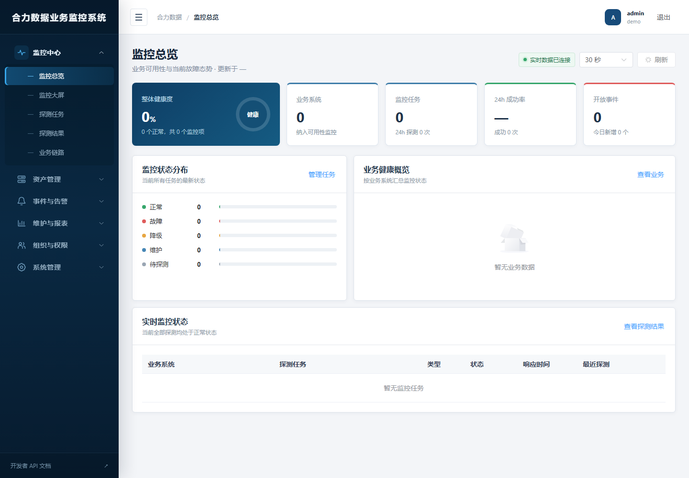

# 合力数据业务监控系统

**当前版本：v1.0.2 · 发布日期：2026-10-24**

业务可用性监控、故障告警与运维管理平台。使用真实探测结果展示业务状态，支持探测任务、历史趋势、故障事件、通知投递、维护窗口和 SLA 报表。



## 功能

| 模块 | 功能 |
| --- | --- |
| 监控中心 | 监控总览、实时大屏、探测任务、探测结果与历史趋势、业务链路 |
| 探测类型 | HTTP、API、TCP、PING、DNS、SSL、MySQL/MariaDB、PostgreSQL、Microsoft SQL Server、MongoDB |
| 历史数据 | 任务内弹窗查看；最长查询 30 天；逐次原始数据、平滑响应曲线、时间缩放和结果明细 |
| 监控大屏 | 默认展示最近 12 小时响应趋势，可筛选其他时间周期 |
| 资产管理 | 业务系统、业务分组、标签与关联关系 |
| 事件与告警 | 故障确认、处理、关闭；告警规则；首次、持续和恢复通知；失败重试 |
| 通知渠道 | SMTP 邮件、Webhook、企业微信、钉钉、Server 酱 |
| 维护与报表 | 维护窗口、SLA 查询与 CSV 导出、公开或受令牌保护的状态页 |
| 组织与权限 | 用户、部门、角色及模块功能授权 |
| 系统管理 | 品牌和刷新周期配置、登录记录、审计日志、系统健康与维护操作 |

历史图表使用原始记录，不按时间桶取平均；统计卡片另行展示平均响应等汇总指标。无探测记录的时段不会补作成功。正常保留策略为每个任务至少保留最近 31 天，超过保护时间后按系统设置的条数清理；删除任务会同时永久删除其相关探测数据。

权限按模块功能控制，目前不提供部门或个人级的数据行隔离。通知渠道中的密码、secret 和 sendkey 等敏感字段加密保存；不要在 URL 或普通请求头中存放不必要的密钥。

## v1.0.2 更新

- 合并结果与历史入口，增加任务历史弹窗，保留每次探测数据并使用平滑曲线。
- 大屏默认 12 小时时间范围，支持按周期查询趋势。
- 完善监控配置、资产关联、事件处理、通知重试、维护报表及状态页校验。
- 完善用户与角色授权边界、自身账号保护、密码更新后的令牌失效和只读交互。
- 优化桌面及移动端布局、页面快捷搜索、表格分页和操作反馈。
- 修复无效排序字段、系统设置类型校验、审计事务一致性及公开品牌接口受过期凭据影响的问题。
- 统一版本文件、前端版本显示、后端 OpenAPI 版本及 Git 标签为 v1.0.2。

## 技术架构与目录

后端使用 Python 3.12、Django 5、Django REST Framework、Channels 和 Celery；前端使用 Vue 3、TypeScript、Vite、Element Plus 和 ECharts。PostgreSQL 存储业务数据，Redis 提供队列和实时消息，Nginx 提供统一入口，通过 Docker Compose 部署。

```text
backend/                  API、探测、告警、权限与自动化测试
frontend/                 管理界面、监控大屏与前端测试
deploy/nginx/             反向代理配置
scripts/app.sh            应用管理与健康检查
scripts/smoke_test.py      HTTP 冒烟检查
docs/                     截图与探测配置说明
offline/                  离线部署脚本及构建说明
VERSION                   发布版本 v1.0.2
docker-compose.yml        在线构建与部署
.env.example              配置模板，不包含生产密钥
```

## 部署

准备 Linux、Docker Engine 24+ 和 Docker Compose v2，预留 Web 端口及持久化存储。建议至少 4 核 CPU、8 GB 内存，实际容量随探测频率及保留量调整。

```bash
git clone https://github.com/leichuanxing/heli_monitor.git
cd heli_monitor
git checkout v1.0.2
cp .env.example .env
chmod 600 .env
```

编辑 `.env`：

- 设置随机 `DJANGO_SECRET_KEY`、`SECRET_ENCRYPTION_KEY`。
- 设置 `POSTGRES_PASSWORD`，并同步 `DATABASE_URL` 的连接凭据。
- 将 `ALLOWED_HOSTS`、`CSRF_TRUSTED_ORIGINS` 改为实际访问域名或 IP。
- 按实际网络配置 `ALLOWED_PROBE_CIDRS`、`BLOCKED_PROBE_PORTS`。
- 按需设置 `NGINX_PORT`、时区和 JWT 有效期。

Secret 密钥可在安装了 `cryptography` 的可信 Python 环境中通过 `Fernet.generate_key()` 生成。保留现有密钥以确保已有加密配置可解密。配置模板需要修改后才能用于生产。

```bash
chmod +x scripts/app.sh
./scripts/app.sh start
docker compose exec backend python manage.py createsuperuser
```

后台入口会执行数据库迁移和静态资源收集。新建或重置用户密码至少 12 位，并通过常见密码、纯数字及账号相似性校验。仓库不提供固定生产管理员账号或密码。

| 地址 | 用途 |
| --- | --- |
| `http://服务器地址/` | 管理平台 |
| `/api/v1/docs/` | API 文档 |
| `/health/live` | 存活检查 |
| `/health/ready` | 数据库、Redis 等就绪检查 |

## 使用流程

1. 建立业务系统，按需配置分组和标签。
2. 创建探测任务并配置该类型参数，执行立即探测验证目标可达。
3. 配置通知渠道和告警规则，在授权的接收目标上验证投递。
4. 从总览、大屏及任务历史弹窗查看状态和响应趋势。
5. 在事件页面确认、处理故障，通过发送记录核对通知结果。
6. 按需建立维护窗口、导出 SLA 或管理状态页访问令牌。

SLA 为保留样本口径，空白时段不计成功；请结合维护窗口和实际保留记录解释报表。公开状态页仅用于展示选定业务信息，发布前核对访问范围。

## 日常运维

```bash
./scripts/app.sh status
./scripts/app.sh health
./scripts/app.sh logs backend
./scripts/app.sh update       # 构建当前目录代码并更新服务
./scripts/app.sh stop         # 保留数据库与 Redis 数据卷
```

`update` 不会自动拉取 Git 提交；先备份数据库、`.env` 和加密密钥，再更新源码并执行部署。容器重建后如反向代理仍使用旧地址，可执行 `docker compose exec nginx nginx -s reload` 平滑重载。不要使用 `docker compose down -v` 进行普通停机，该命令会删除数据卷。

## 开发与验证

以下后端命令要求已配置 `.env`、启动 PostgreSQL/Redis，并构建当前后端镜像：

```bash
docker compose run --rm backend ruff check .
docker compose run --rm backend pytest -o addopts='' -q
docker compose run --rm backend python manage.py makemigrations --check --dry-run
docker compose run --rm backend python manage.py spectacular --validate --file /tmp/schema.yml
docker compose exec backend python manage.py check_application
python3 scripts/smoke_test.py http://127.0.0.1
```

前端使用 Node.js 22，在源码目录执行：

```bash
cd frontend
npm install --no-audit --no-fund
npm run lint
npm test
npm run build
```

生产前端镜像只提供静态资源，不包含 Node.js；不要在运行中的前端容器内执行 npm 命令。`docker compose build frontend` 的构建阶段会执行 ESLint、测试、TypeScript 检查及 Vite 构建。

## 离线部署

离线脚本见 [offline/README.md](offline/README.md)。需自行准备匹配版本的应用镜像归档、Docker RPM 及代码归档，再运行 `offline/build-package.sh`。脚本根据根目录 `VERSION` 命名，例如 `heli-monitor-offline-v1.0.2-el9-x86_64.tar.gz`。

Git 源码和标签不包含生产 `.env`、数据库、备份、离线镜像或完整离线安装包；旧版本镜像归档不能视为 v1.0.2 交付物。

## 排障

- 页面或 API 无法访问：检查 `scripts/app.sh health`、Nginx 日志、端口及访问域名配置。
- 探测结果不更新：检查 backend、worker、beat 和 Redis，确认任务已启用、业务未暂停且目标在允许范围内。
- 通知未送达：检查规则关联、渠道启停、事件状态和发送记录；外部渠道是否可达需要实际环境验证。
- 更新后登录失效：重新登录；密码变更或令牌过期会使旧会话失效。
- 密钥丢失：加密配置不能通过重置密钥恢复，需找回原密钥或重新录入相关配置。
